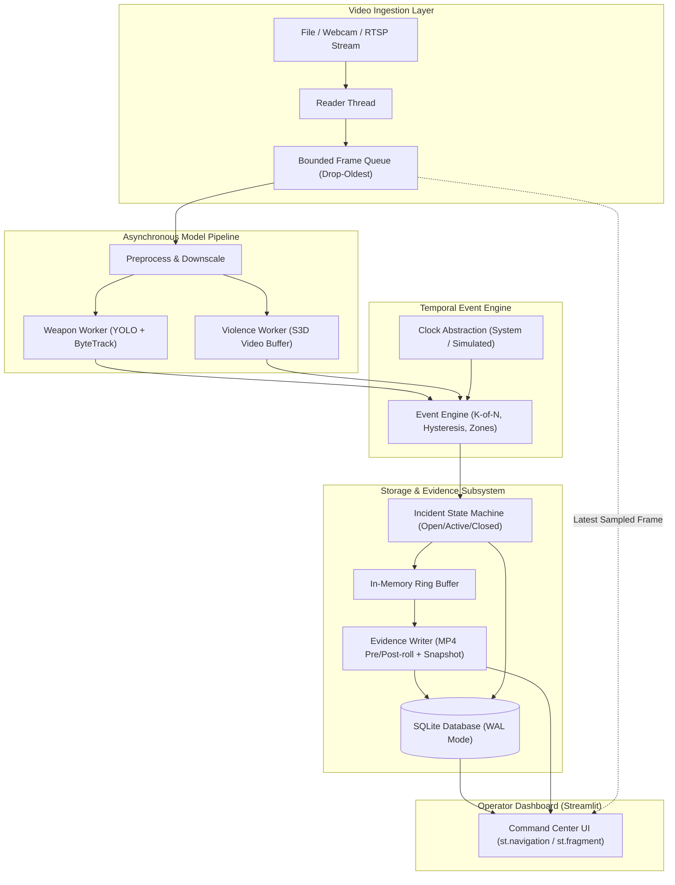

# FAST-TRACK AI Architecture Specification

FAST-TRACK AI is a real-time, human-in-the-loop multi-camera surveillance platform designed for authorized security control rooms to detect possible weapons and violence.

## System Components

1. **Video Ingestion:**
   - Reader threads pull frames from RTSP streams, webcams, or pre-recorded video files.
   - Bounded queues drop older frames when the inference worker falls behind, preventing latency buildup.
   - RTSP credentials are automatically sanitized to prevent accidental credential leakage.

2. **Inference Pipeline:**
   - **Weapon Detector:** Ultralytics YOLO nano with ByteTrack tracking IDs. Candidate detections require $K$-of-$N$ temporal confirmation (e.g., 3 detections across 5 consecutive sampled frames).
   - **Violence Classifier:** Rolling time-based window (e.g., 2.0 seconds, 16 frames) processed by TorchVision S3D / R3D-18. Score outputs include raw probability, temperature-calibrated probability, and EMA smoothing.

3. **Event Engine & State Machine:**
   - Hysteresis thresholds ($T_{\text{on}}$ and $T_{\text{off}}$) prevent alert flickering.
   - Incident severity triage:
     - `INFO`: System / heartbeat notice.
     - `LOW`: Single weak or unconfirmed detection.
     - `MEDIUM`: Confirmed weapon track OR confirmed violence window.
     - `HIGH`: Confirmed weapon detection temporally overlapping with confirmed violence on the same camera.
   - Polygons filter regions of interest (Include/Ignore zones).
   - Rate limiting and alert-storm dampening protect operators from alert fatigue.

4. **Evidence Subsystem:**
   - In-memory ring buffer keeps JPEG-compressed frames from the preceding $N$ seconds.
   - Triggering an incident captures pre-roll footage, post-roll footage, and a key annotated snapshot.
   - SHA-256 hashes are calculated on disk write for chain-of-custody verification.

5. **Security & Human-in-the-Loop:**
   - Strictly prediction-based: UI labels display "possible violence" or "detected object: knife (0.78)".
   - Operators can review, verify, mark as false alarm, or escalate incidents with audit notes.
   - No face recognition, demographic profiling, or automated police dispatch is permitted.
