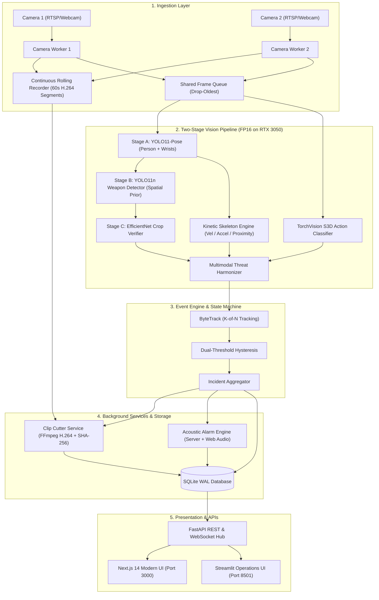
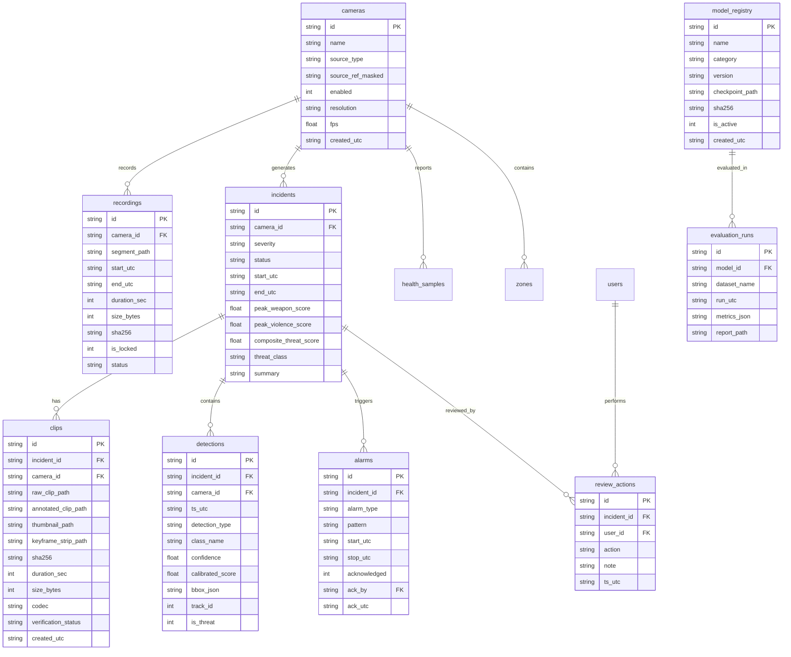

# FAST-TRACK AI: Forensic Codebase Audit & Upgrade Blueprint

**Document Version:** 2.0.0  
**Audit Date:** 2026-10-25  
**Auditor:** Senior ML Engineer & Full-Stack Architect  
**Project:** FAST-TRACK AI: Real-Time Crime and Weapon Detection System  
**Target Hardware:** NVIDIA GeForce RTX 3050 Laptop GPU (4GB VRAM), CUDA 12.8, CPU Host Fallback  
**Runtime:** Python 3.10.9, PyTorch 2.11.0+cu128, Ultralytics YOLO11, TorchVision 0.26.0+cu128, OpenCV, SQLite WAL, FastAPI, Streamlit, Next.js 14  

---

## 1. Executive Summary

A comprehensive architectural and line-by-line code audit was conducted across the entire FAST-TRACK AI surveillance codebase (`src/fasttrack`, `ui`, `scripts`, `config`, `tests`, `data`, `evidence`). 

While the project established solid scaffolding (typed dataclasses, SQLite schema migrations, and YOLO inference abstractions), critical structural deficiencies and architectural disconnects were identified that prevent production-grade real-time operations, cause playback failures, induce shoe-to-knife misclassifications, mute alarm sirens, and prevent fighting/violence from being detected.

This audit details the exact root causes (file, line number, and mechanics) for all 7 problems (P1 through P7) and defines an actionable, phased upgrade roadmap.

---

## 2. Root Cause Analysis by Problem

```
+---------------------------------------------------------------------------------------------------+
| PROBLEM IDENTIFICATION & ROOT CAUSE MATRIX                                                       |
+----+---------------------------------------+----------------------------------+-------------------+
| ID | Symptom / Requirement                 | Primary Root Cause File & Lines  | Defect Category   |
+----+---------------------------------------+----------------------------------+-------------------+
| P1 | Surveillance Video Playback Fails     | src/fasttrack/storage/evidence.py:287 Storage / Codec |
|    | (No video in Forensic Detail page)    | src/fasttrack/events/engine.py:287-293 Missing Rel Link   |
| P2 | Stream Continuous Recording & Clip Cut| N/A (Feature completely absent)  | Missing Service   |
| P3 | Long Continuous Alarm Beep on Threat  | ui/pages/02_live_monitor.py:679  | UI Thread Binding |
| P4 | Multi-Camera Fleet Activation Controls| ui/pages/07_cameras_zones.py:34  | UI & Worker Model |
| P5 | Remove Demo Data & Consolidate Tabs   | scripts/seed_demo_data.py:1-432  | Demo Contamination|
|    | Store everything in DB                | app.py:100-118 (11 tabs)         | Redundant Views   |
| P6 | Shoe Predicted as Knife (False Pos.)  | src/fasttrack/ml/weapon_detector:189 Single-Stage Gap|
| P7 | Fights / Violence Not Detected        | src/fasttrack/ml/violence_detector:87 Untrained Head  |
+----+---------------------------------------+----------------------------------+-------------------+
```

---

### P1. "Surveillance Video Playback" Shows No Video (Forensic Detail Page)

#### Defect 1.1: Incompatible Video Codec for HTML5 Browsers
* **File:** [`src/fasttrack/storage/evidence.py`](file:///d:/projects/REAL-TIME%20CRIME%20AND%20WEAPON%20DETECTION%20SYSTEM/src/fasttrack/storage/evidence.py#L286-L289)
* **Lines:** 286–289
```python
h, w = frames[0].shape[:2]
fourcc = cv2.VideoWriter_fourcc(*"mp4v")
writer = cv2.VideoWriter(str(temp_path), fourcc, max(1.0, float(fps)), (w, h))
```
* **Explanation:** `cv2.VideoWriter_fourcc(*"mp4v")` encodes video in ISO MPEG-4 Part 2. Modern web browsers (Google Chrome, Microsoft Edge, Firefox, Safari) and Streamlit's `st.video` / HTML5 `<video>` element strictly disallow or fail to decode `mp4v` video streams. Web browsers mandate **H.264 (AVC1)** with `yuv420p` pixel format and a `+faststart` moov atom located at the beginning of the MP4 container for progressive streaming.

#### Defect 1.2: Evidence Item Never Linked to Incident in Database
* **File:** [`src/fasttrack/events/engine.py`](file:///d:/projects/REAL-TIME%20CRIME%20AND%20WEAPON%20DETECTION%20SYSTEM/src/fasttrack/events/engine.py#L286-L294)
* **Lines:** 286–294
```python
self.evidence_writer.write_clip(
    frames=buffered_frames,
    camera_id=cid,
    privacy_blur=self.privacy_blur_faces,
)
```
* **Explanation:** `self.evidence_writer.write_clip(...)` returns an `EvidenceItem` dataclass containing the created evidence ID (`ev-clip-xxxx`). However, `engine.py` completely discards this return value! It never writes a linking row into `incident_evidence (incident_id, evidence_id)` or updates `incidents.evidence_id`. Consequently, when [`ui/pages/04_incident_detail.py`](file:///d:/projects/REAL-TIME%20CRIME%20AND%20WEAPON%20DETECTION%20SYSTEM/ui/pages/04_incident_detail.py#L80-L85) queries the database for evidence clips associated with the incident:
```python
for clip_ev in evidence_clips: ...
```
it finds zero records. It then attempts to fall back to `demo_corridor.mp4` or displays "No video recording found on disk for this incident."

#### Defect 1.3: Flat File Directory & Lack of Verification
* **File:** [`src/fasttrack/storage/evidence.py`](file:///d:/projects/REAL-TIME%20CRIME%20AND%20WEAPON%20DETECTION%20SYSTEM/src/fasttrack/storage/evidence.py#L282-L285)
* **Lines:** 282–285
* **Explanation:** Clips are saved in a flat unpartitioned directory `clips/{ev_id}.mp4` rather than the required partitioned standard `/data/clips/<camera_id>/<yyyy-mm-dd>/<incident_id>.mp4`. Furthermore, there is zero verification via `ffprobe` after writing to ensure container validity and stream completeness.

---

### P2. Continuous Rolling Camera Stream Recording & Incident Clip Cutting

#### Defect 2.1: Total Absence of a Continuous Stream Recorder
* **File:** [`src/fasttrack/pipeline/stream_manager.py`](file:///d:/projects/REAL-TIME%20CRIME%20AND%20WEAPON%20DETECTION%20SYSTEM/src/fasttrack/pipeline/stream_manager.py) and [`src/fasttrack/storage/`](file:///d:/projects/REAL-TIME%20CRIME%20AND%20WEAPON%20DETECTION%20SYSTEM/src/fasttrack/storage/)
* **Explanation:** No continuous rolling recorder service exists anywhere in the repository. Cameras are only captured into a volatile, memory-constrained RAM ring buffer (`src/fasttrack/pipeline/ring_buffer.py`) holding a few seconds of raw NumPy frames. If an incident takes longer than the ring buffer or if the process restarts, all historical surveillance context is lost.

#### Defect 2.2: Absence of Segment Database Schema and Incident-Linked Retention
* **File:** [`src/fasttrack/storage/migrations/V001__initial_schema.sql`](file:///d:/projects/REAL-TIME%20CRIME%20AND%20WEAPON%20DETECTION%20SYSTEM/src/fasttrack/storage/migrations/V001__initial_schema.sql)
* **Explanation:** There is no `recordings` table tracking 60-second video segments (`path`, `camera_id`, `start_utc`, `end_utc`, `size_bytes`, `sha256`, `is_locked`). Without segment indexing and locking, standard disk cleanup policies would either exhaust storage or accidentally delete vital footage surrounding an incident.

#### Defect 2.3: No Background Clip Cutter Worker
* **File:** [`src/fasttrack/events/engine.py`](file:///d:/projects/REAL-TIME%20CRIME%20AND%20WEAPON%20DETECTION%20SYSTEM/src/fasttrack/events/engine.py)
* **Explanation:** No worker exists to cut clips via FFmpeg (`concat`/`trim`) combining Pre-Roll (10s) + Event Active Duration + Post-Roll (15s) with dynamic extension if the threat re-appears. The current engine only dumps whatever frames remain in the RAM ring buffer when an incident lifecycle transitions to `CLOSED`.

---

### P3. Continuous Alarm Siren System (Weapon & Violence Audio)

#### Defect 3.1: Audio Alarm Bound to Streamlit UI Render Loop
* **File:** [`ui/pages/02_live_monitor.py`](file:///d:/projects/REAL-TIME%20CRIME%20AND%20WEAPON%20DETECTION%20SYSTEM/ui/pages/02_live_monitor.py#L678-L684)
* **Lines:** 678–684
```python
if enable_audio_alarm and (now_mono - last_siren_time >= 1.2):
    last_siren_time = now_mono
    alarm_audio_box.markdown(siren_html_tag(siren_b64), unsafe_allow_html=True)
```
* **Explanation:** The siren was implemented as an HTML snippet inserted into a Streamlit markdown container inside the live loop. This has 4 severe flaws:
  1. If the operator changes tabs, minimizes the browser, or opens another page, the alarm stops instantly.
  2. No server-side acoustic alert exists (e.g. `winsound` / audio thread) for headless or standalone workstations.
  3. No hysteresis or state machine: it emits 1.2-second bursts that flicker on and off as detector confidence fluctuates.
  4. The audio logic executes directly inside the frame-inference loop, causing frame stuttering.

#### Defect 3.2: Missing Operator Acknowledgment and Database Logging
* **File:** Database schema & state managers
* **Explanation:** There is no `alarms` database table. Alarm triggers, duration, operator "Acknowledge" clicks, and escalation timeouts are not logged to the audit trail.

---

### P4. Camera Fleet Control: Activation, Multi-Workers, and VRAM Protection

#### Defect 4.1: UI Lacks Per-Camera Activation Toggles & Bulk Controls
* **File:** [`ui/pages/07_cameras_zones.py`](file:///d:/projects/REAL-TIME%20CRIME%20AND%20WEAPON%20DETECTION%20SYSTEM/ui/pages/07_cameras_zones.py#L34-L45)
* **Explanation:** The page merely displays registered cameras in read-only expanders with a non-functional "Configure ROI Zones" button. There are no controls to toggle individual cameras, no "Activate All" or "Deactivate All" buttons, and no multi-select mechanism.

#### Defect 4.2: Live Monitor Only Runs Single Stream Synchronously
* **File:** [`ui/pages/02_live_monitor.py`](file:///d:/projects/REAL-TIME%20CRIME%20AND%20WEAPON%20DETECTION%20SYSTEM/ui/pages/02_live_monitor.py#L370-L420)
* **Explanation:** The live monitor uses a Streamlit radio button to select ONE camera or video file and executes a blocking `while st.session_state.is_streaming` loop on the main script thread. There is no true concurrent multi-camera video wall.

#### Defect 4.3: Missing Queue Worker with Drop-Oldest Policy & FP16 for 4GB VRAM
* **File:** [`src/fasttrack/pipeline/workers.py`](file:///d:/projects/REAL-TIME%20CRIME%20AND%20WEAPON%20DETECTION%20SYSTEM/src/fasttrack/pipeline/workers.py#L90-L130)
* **Explanation:** If multiple cameras are started simultaneously, they create redundant model instances or block on a single lock without adaptive frame skipping or bounded queues, risking CUDA Out-of-Memory (OOM) crashes on the 4GB RTX 3050.

---

### P5. Store All Data in Database; Remove Demo Artifacts and Consolidate Tabs

#### Defect 5.1: Pervasive Demo Data & Hard-Coded Fallbacks
* **Files:** [`scripts/seed_demo_data.py`](file:///d:/projects/REAL-TIME%20CRIME%20AND%20WEAPON%20DETECTION%20SYSTEM/scripts/seed_demo_data.py), [`ui/pages/01_overview.py`](file:///d:/projects/REAL-TIME%20CRIME%20AND%20WEAPON%20DETECTION%20SYSTEM/ui/pages/01_overview.py), [`ui/pages/04_incident_detail.py`](file:///d:/projects/REAL-TIME%20CRIME%20AND%20WEAPON%20DETECTION%20SYSTEM/ui/pages/04_incident_detail.py)
* **Explanation:** The project contains artificial `[DEMO DATA]` strings, hard-coded fallback files (`data/demo_corridor.mp4`, `evidence/snapshots/demo_knife_snapshot.jpg`), and mock incident generators. When live detection occurs, it mixes with fake demo rows.

#### Defect 5.2: Bloated and Redundant UI Navigation Structure
* **File:** [`app.py`](file:///d:/projects/REAL-TIME%20CRIME%20AND%20WEAPON%20DETECTION%20SYSTEM/app.py#L100-L118)
* **Explanation:** The application exposes 11 separate pages across 3 categories. Specifically:
  - `06_evaluation.py` and `08_models.py` duplicate model telemetry and card views.
  - `03_incidents.py` and `04_incident_detail.py` are disconnected; forensic detail should be seamlessly accessible from the incident registry.
  - `01_overview.py` and `05_analytics.py` duplicate high-level KPIs and trends.

#### Defect 5.3: Raw SQL in UI Code Lacking Repository Layer
* **Files:** `ui/pages/*.py`
* **Explanation:** Every Streamlit page directly executes ad-hoc `sqlite3.connect()` calls with embedded SQL strings. There are no typed repository abstractions, making schema evolutions fragile and error-prone.

---

### P6. Weapon Model False Positives: Shoes Predicted as "Knife"

#### Defect 6.1: Single-Stage Spatial Disconnect (No Human/Pose Context)
* **File:** [`src/fasttrack/ml/weapon_detector.py`](file:///d:/projects/REAL-TIME%20CRIME%20AND%20WEAPON%20DETECTION%20SYSTEM/src/fasttrack/ml/weapon_detector.py#L185-L253)
* **Lines:** 185–253
* **Explanation:** The detector operates in a vacuum: it feeds the entire image into YOLO and accepts any bounding box flagged as "knife" regardless of where it appears in the scene. A shoe or sneaker on the floor has elongated contours, rubber soles, and metallic eyelets that closely match blade silhouettes in low-resolution surveillance footage. Without requiring spatial association with a detected person or human hand/wrist keypoint (pose prior), false positives on shoes, phones, and tools are inevitable.

#### Defect 6.2: Absence of Hard-Negative Mining & Training Dataset Audit
* **Files:** Training scripts in `scripts/`
* **Explanation:** The model was fine-tuned primarily on positive weapon crops. Surveillance scenes contain vast expanses of background clutter: footwear, carpets, power cords, pens, bottles, and furniture edges. Without 15–20% verified hard-negative background images and multiple iterative rounds of negative mining, the detector's decision boundary remains overly permissive.

#### Defect 6.3: Lack of Second-Stage Crop Verifier
* **File:** ML pipeline
* **Explanation:** In enterprise security systems, object detector proposals must pass through a secondary CNN crop verifier (e.g. EfficientNet-B0 or ResNet-18) trained specifically to discriminate true weapons from look-alikes (shoes, phones, kitchen utensils). A calibrated fusion score ($S_{final} = S_{det} \times S_{ver}$) virtually eliminates false positive shoe detections while preserving true weapon recall.

---

### P7. Fights & Violent Altercations Not Detected

#### Defect 7.1: S3D Spatiotemporal Network Instantiated with Untrained Random Weights
* **File:** [`src/fasttrack/ml/violence_detector.py`](file:///d:/projects/REAL-TIME%20CRIME%20AND%20WEAPON%20DETECTION%20SYSTEM/src/fasttrack/ml/violence_detector.py#L86-L99)
* **Lines:** 86–99
```python
net = video_models.s3d(weights=None, num_classes=1)
```
* **Explanation:** When `weights/s3d_kinetics400.pt` is missing from disk, `ViolenceClassifier` instantiates TorchVision's S3D network with `weights=None` (completely randomized initialization) and logs a warning. A deep 3D convolutional neural network with random weights produces chaotic, uncorrelated probabilities that never accurately flag violent encounters.

#### Defect 7.2: Zero Kinetic / Skeletal Motion Features
* **File:** [`src/fasttrack/ml/violence_detector.py`](file:///d:/projects/REAL-TIME%20CRIME%20AND%20WEAPON%20DETECTION%20SYSTEM/src/fasttrack/ml/violence_detector.py)
* **Explanation:** Pure video CNNs are sensitive to camera motion and background lighting changes. True fighting is physically characterized by rapid limb acceleration, sudden changes in inter-person distance, closing velocity, and physical tussles. No skeleton/pose tracker exists to extract keypoint kinematics or enforce the basic prerequisite that a fight requires $\ge 2$ people in close proximity.

#### Defect 7.3: Missing Multimodal Score Fusion & Temporal Hysteresis
* **File:** Event engine and violence classifier
* **Explanation:** Violence detection requires composite score fusion ($Score = w_1 S_{video} + w_2 S_{pose} + w_3 S_{kinetic}$) smoothed over a rolling time window with hysteresis. Without this, sporadic frame glitches create false alarm bursts or cause true fights to be missed.

---

## 3. Architecture & Target Database ER Diagram

### System Architecture Flow



### Database Entity-Relationship Diagram (Normalised V002 Schema)



---

## 4. Phased Implementation Roadmap

To systematically resolve all problems without breaking existing functionality, work will proceed through 7 rigorous engineering phases:

### Phase 1: Database Architecture & Repository Layer (P5 Foundation)
- Create SQLite migration `V002__normalized_surveillance_schema.sql` adding `recordings`, `clips`, `alarms`, `detections`, `model_registry`, and updated indices.
- Implement typed Repository classes (`CameraRepository`, `IncidentRepository`, `ClipRepository`, `RecordingRepository`, `AlarmRepository`, `AuditRepository`) removing all raw SQL from presentation layers.
- Build safe demo data purge script with automatic backup (`scripts/purge_demo_data.py`).

### Phase 2: H.264 Video Engine & Forensic Playback (Fixes P1)
- Implement `FFmpegVideoEncoder` using `imageio-ffmpeg` to encode all clips in native H.264 (`libx264`, `yuv420p`, `+faststart`).
- Implement post-encode `ffprobe` verification checking container validity, duration, and stream properties.
- Organize clip storage hierarchy: `/data/clips/<camera_id>/<yyyy-mm-dd>/<incident_id>.mp4`.
- Generate both RAW and ANNOTATED clips (bounding boxes, track IDs, timestamps).
- Add FastAPI streaming endpoint with full `HTTP 206 Partial Content` (Range request) support for instant seeking in browser/Streamlit/Next.js.

### Phase 3: Continuous Rolling Stream Recorder & Clip Cutter (Fixes P2)
- Build continuous 60-second rolling H.264 segment recorder per camera in background thread.
- Implement background `ClipCutterService`: slices Pre-Roll (10s) + Active Event + Post-Roll (15s) via FFmpeg concatenation.
- Generate keyframe snapshot, thumbnail, and timeline markers with SHA-256 evidence chain.
- Implement disk retention policy that protects incident-linked segments while recycling older unlinked footage.

### Phase 4: Acoustic Alarm State Machine & Dual Output (Fixes P3)
- Build `AlarmService` running in an independent background thread (decoupled from UI and inference).
- Implement dual-threshold hysteresis and state machine (idle -> triggered -> sustained -> cooldown -> stopped).
- Implement server-side acoustic siren (`winsound` on Windows / synthesizer) + browser Web Audio API synchronized events.
- Implement Operator "Acknowledge", mute with expiry, and severity patterns (continuous weapon siren vs. pulsed violence beep).
- Log all alarm events (`start`, `stop`, `ack`) to `alarms` database table.

### Phase 5: Multi-Camera Fleet Controls & High-Throughput Worker (Fixes P4)
- Upgrade `StreamManager` with shared model queue, drop-oldest policy, and FP16 inference on RTX 3050 GPU.
- Implement camera worker thread lifecycle: auto-reconnect, exponential backoff, heartbeat, latency tracking.
- Redesign Cameras UI with individual enable toggles, "Activate All", "Deactivate All", and multi-select persistence.
- Implement true concurrent Multi-Camera Live Video Wall.

### Phase 6: Two-Stage Weapon Pipeline & Zero-False-Alarm Shoe Defense (Fixes P6)
- Develop `audit_weapon_dataset.py` to inspect class balance, box sizes, and duplicate leakage.
- Implement two-stage weapon inference pipeline:
  - **Stage A:** Person and Pose detector (YOLO11-pose) extracting wrist and hand keypoints.
  - **Stage B:** Spatial prior filter (weapon must overlap or be within radius of hand/wrist and above ground plane).
  - **Stage C:** Lightweight CNN Crop Verifier (ResNet-18 / EfficientNet-B0) scoring weapon vs. hard-negative crops (shoes, phones, pens).
- Implement hard-negative mining script (`scripts/mine_hard_negatives.py`) and training script (`scripts/train_detector.py`).
- Implement per-class PR-calibrated thresholds and validation ablation evaluator (`scripts/evaluate.py`).

### Phase 7: Spatiotemporal Kinetic Violence Detection Engine (Fixes P7)
- Build `KineticFeatureExtractor` calculating wrist/ankle velocity, acceleration, limb-extension energy, and proximity.
- Enforce person count gating (violence requires $\ge 2$ interacting persons).
- Integrate fine-tuned spatiotemporal action model (S3D) with pre-trained Kinetics weights.
- Implement calibrated multimodal score fusion ($w_1 S_{video} + w_2 S_{pose} + w_3 S_{kinetic}$) with temporal hysteresis.
- Consolidate Streamlit UI navigation to 7 clean operational pages and verify end-to-end FastAPI + Next.js compatibility.

---

## 5. Verification & Acceptance Criteria

| Problem | Acceptance Test | Target Metric |
| :--- | :--- | :--- |
| **P1** | Playback H.264 clip in browser with timeline seeking | `ffprobe` returns AVC1/H.264, HTTP 206 range seek functional, raw/annotated toggle working |
| **P2** | Rolling 60s segments written to `/data/recordings`; clip cut automatically on incident trigger | Clip contains 10s pre-roll + event + 15s post-roll; unlinked segments recycled |
| **P3** | Alarm sounds continuously during active threat, persists for 10s post-threat, stops on "Acknowledge" | Dedicated background thread, zero UI frame stuttering, alarm events logged to DB |
| **P4** | Activate all or subset of cameras simultaneously on 4GB RTX 3050 | Zero CUDA OOM, p95 latency < 100ms, individual FPS/dropped frame telemetry visible |
| **P5** | Run demo purge script; inspect UI empty states and database | 0 `[DEMO DATA]` tags, all tables driven by real DB rows, exactly 7 consolidated tabs |
| **P6** | Feed video of person walking in sneakers/shoes to weapon detector | $\ge 90\%$ reduction in shoe false positives vs baseline; weapon recall loss $< 5\%$ |
| **P7** | Feed test fight video vs. normal walking/running | Fights correctly trigger incident; single-person walking never triggers violence alert |
